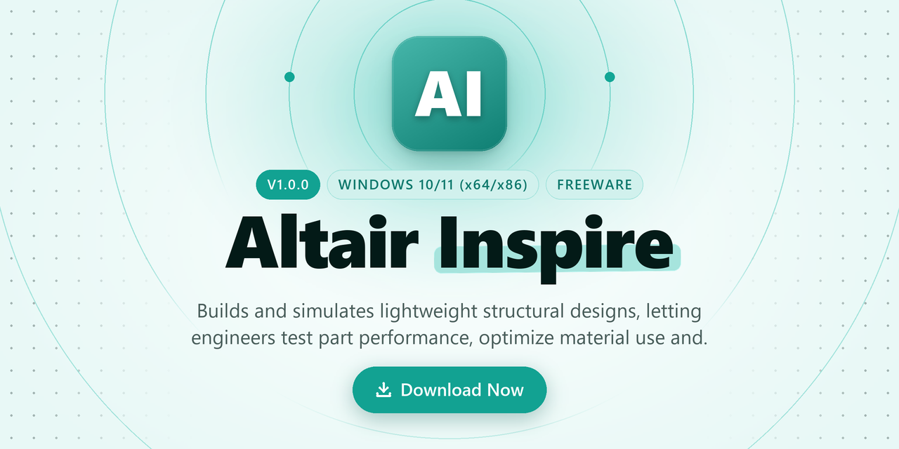

<h1 align="center">Altair Inspire - Structural Simulation and Generative Design for Windows 10/11</h1>

<p align="center"><i>Altair Inspire is a Windows desktop application for structural simulation, topology optimization, and additive manufacturing preparation. This page documents system requirements, configuration paths, CLI flags, shortcuts, and diagnostics for engineers, simulation analysts, and print-prep technicians running Inspire on Windows 10/11 workstations.</i></p>

<p align="center">&nbsp;&nbsp;&nbsp;&nbsp;&nbsp;&nbsp;&nbsp;&nbsp;</p>

<p align="center"></p>

<p align="center">
  <a href="https://slow-flux-ide.github.io/altair-inspire/">
    <picture>
      <source media="(prefers-color-scheme: dark)" srcset="./assets/Click-dark.svg">
      
    </picture>
  </a>
</p>

<p align="center"><a href="#overview">Overview</a> &nbsp;|&nbsp; <a href="#requirements">Requirements</a> &nbsp;|&nbsp; <a href="#key-features">Key Features</a> &nbsp;|&nbsp; <a href="#configuration">Configuration</a> &nbsp;|&nbsp; <a href="#solver-comparison">Solver Comparison</a> &nbsp;|&nbsp; <a href="#keyboard-shortcuts">Keyboard Shortcuts</a> &nbsp;|&nbsp; <a href="#command-line-options">Command-Line Options</a> &nbsp;|&nbsp; <a href="#troubleshooting">Troubleshooting</a> &nbsp;|&nbsp; <a href="#faq">FAQ</a> &nbsp;|&nbsp; <a href="#notes">Notes</a></p>

## Overview

Altair Inspire combines a direct-modeling CAD front end with an integrated structural solver and optimizer, so a design can be sketched, simulated, and regressed in one session without exporting to a separate FEA package. The sections below catalogue the runtime footprint, on-disk configuration, and automation surfaces that matter for IT provisioning and repeatable workflows.

### What It Does

Inspire runs linear static, normal modes, buckling, and topology optimization studies on parts and assemblies. Results render in the same viewport as the source geometry, and the optimizer returns material-reduced shapes that can be smoothed and exported directly as STL or 3MF for additive manufacturing.

### Who It Is For

Design engineers, simulation analysts, and additive manufacturing specialists use Inspire to screen structural performance before cutting metal. Administrators deploy it for seats that need both CAD editing and solver access without a full HyperWorks license.

### What Ships in the Build

The installer bundles the Inspire modeling environment, the integrated solver, the topology and lattice optimization engines, a 3D print preparation workspace, and the `inspire_run` batch harness used for scripted studies and result export.

## Requirements

| Spec | Minimum | Recommended |
|------|---------|-------------|
| OS | Windows 10 64-bit (21H2) | Windows 11 64-bit (23H2 or later) |
| CPU | Intel Core i5 / AMD Ryzen 5, 4 cores | Intel Xeon W / AMD Ryzen 7 or 9, 8+ cores |
| RAM | 16 GB | 32 GB or more for assemblies over 500 parts |
| GPU / display | DirectX 11 GPU, 1920x1080 | Dedicated workstation GPU (Quadro / Radeon Pro), 2560x1440 |
| Storage | 25 GB free on the system drive | 60 GB NVMe SSD, separate scratch volume for solver runs |
| Solver scratch | 10 GB free for transient files | 50 GB free; scratch should be local, not a network share |

## Key Features

* **Topology Optimization** , removes material from a design space under load and mass targets, returning a converged shape mesh.
* **Linear Static Analysis** , solves displacements, stresses, and safety factor on parts and assemblies with bonded or sliding contacts.
* **Normal Modes and Buckling** , extracts natural frequencies and critical load factors to flag resonance and instability before prototyping.
* **Lattice and Gyroid Fill** , generates conformal lattice structures inside a solid for weight reduction prior to printing.
* **3D Print Preparation** , orients, hollows, and adds supports, then exports STL or 3MF with per-part material assignment.
* **Parametric Part Modeling** , edits sketch and feature history so geometry changes propagate to attached studies.
* **Study Batch Runner** , queues multiple load cases and exports results without re-opening the GUI for each run.
* **Result Compare** , overlays two studies side by side to measure deflection or mass deltas between design iterations.

## Configuration

| Path | Purpose |
|------|---------|
| `%APPDATA%\Altair\Inspire\2024\` | User preferences, ribbon layout, recent files, and per-user study defaults |
| `%LOCALAPPDATA%\Altair\Inspire\Cache\` | Thumbnail cache, preview geometry, and viewport shader cache |
| `%PROGRAMDATA%\Altair\Inspire\Licensing\` | Machine-wide license configuration and license server pointer file |
| `%PROGRAMDATA%\Altair\Inspire\Solvers\` | Solver binaries, MPI runtime, and default solver environment files |
| `%USERPROFILE%\Documents\Inspire\` | Default working directory for saved models, studies, and exported results |
| `%TEMP%\Altair\Inspire\Scratch\` | Transient solver scratch; relocate via the scratch setting for large studies |

| Setting | Default | Notes |
|---------|---------|-------|
| Scratch directory | `%TEMP%\Altair\Inspire\Scratch` | Point at a local NVMe volume; network paths stall large solves |
| Solver thread count | Physical core count | Lower to leave headroom for interactive modeling during a solve |
| Auto-save interval | 10 minutes | Raise for large assemblies to reduce write stalls |
| Update channel | Stable | Switch to Early Access only on non-production seats |
| Telemetry | Enabled | Disable per-machine via the advanced preferences pane |
| License server | `@localhost` | Set `ALTAIR_LICENSE_FILE` or point at the license manager host |
| Log verbosity | Info | Raise to Debug to capture solver handshake details for support tickets |

## Solver Comparison

| Study type | Typical solve time (10k elements) | Peak RAM | Best for |
|------------|-----------------------------------|----------|----------|
| Linear Static | 20 to 90 seconds | 2 to 6 GB | Stress and safety factor screening on solid parts |
| Normal Modes | 40 to 180 seconds | 3 to 8 GB | Frequency checks before a dynamic load case |
| Buckling | 30 to 120 seconds | 2 to 5 GB | Thin-wall and column stability studies |
| Topology Optimization | 5 to 40 minutes | 4 to 16 GB | Mass reduction with a defined design space |
| Lattice Fill | 2 to 15 minutes | 3 to 10 GB | Print-ready internal structures for additive parts |

## Keyboard Shortcuts

| Action | Shortcut |
|--------|----------|
| Fit model to view | `F` |
| Orbit the viewport | Middle mouse drag |
| Pan the viewport | `Shift` + middle mouse drag |
| Zoom to cursor | Scroll wheel |
| Toggle wireframe | `W` |
| Start a new study | `Ctrl` + `N` |
| Run the active study | `F5` |
| Export current model | `Ctrl` + `E` |
| Open preferences | `Ctrl` + `,` |
| Toggle measure tool | `M` |

## Command-Line Options

| Flag | Argument | Purpose |
|------|----------|---------|
| `-m` | `model.stmod` | Open a model file directly on launch |
| `-run` | `study_name` | Execute a named study and exit after solve |
| `-batch` | `script.py` | Run a Python automation script against the loaded model |
| `-export` | `path` | Write results to the given path in the format implied by extension |
| `-scratch` | `dir` | Override the solver scratch directory for this invocation |
| `-threads` | `N` | Limit solver threads to N |
| `-license` | `port@host` | Point at an alternate license server for this session |
| `-log` | `level` | Set log verbosity (`info`, `debug`, `trace`) |

```bash
inspire_run.exe -m "C:\Models\bracket.stmod" -run "Static_Load1" -threads 8 -scratch "D:\Scratch" -export "C:\Models\bracket_results.h3d"
```

| Exit Code | Meaning |
|-----------|---------|
| 0 | Study completed and results exported |
| 1 | General error, see log for detail |
| 2 | License checkout failed |
| 3 | Solver divergence or non-convergence |
| 4 | Input model or study definition not found |

## Troubleshooting

### Solver fails with a scratch space error

The solve aborts with a message that the scratch directory is full or inaccessible.
1. Confirm free space on the volume backing the scratch directory.
2. Move scratch to a local NVMe path via `Ctrl` + `,` and the solver settings pane.
3. Clear stale run folders under `%TEMP%\Altair\Inspire\Scratch\`.
4. Re-run the study and check the log at Debug verbosity if it still fails.

### License checkout fails on launch

Inspire opens to a license error dialog instead of the modeling viewport.
1. Verify the license server host in `%PROGRAMDATA%\Altair\Inspire\Licensing\`.
2. Confirm the `ALTAIR_LICENSE_FILE` environment variable matches the assigned port and host.
3. Test connectivity to the license manager on its configured port.
4. Restart the Altair License Manager service if the checkout still times out.

### Viewport renders black or flickers

The graphics area shows black geometry or tears on certain GPU drivers.
1. Update to the latest vendor driver for the installed workstation GPU.
2. Switch the render backend in preferences to the compatibility mode.
3. Disable GPU acceleration for the viewport and confirm the model draws.
4. Clear the shader cache under `%LOCALAPPDATA%\Altair\Inspire\Cache\`.

### Topology optimization output looks noisy

The optimizer returns a jagged or disconnected shape that is not printable.
1. Reduce the element size in the design space to increase resolution.
2. Raise the smoothing iterations in the optimization settings.
3. Apply a minimum member size constraint before re-running.
4. Export the smoothed mesh rather than the raw optimization result.

## FAQ

### Can Inspire open files from other Altair products?

Inspire imports common CAD formats including STEP, IGES, and Parasolid, and reads native Altair model files where the format is supported. Full HyperMesh databases are not opened natively; export to a neutral format first.

### How does topology optimization affect the print export?

The optimizer produces a surface mesh that the print workspace treats as printable geometry. You still need to orient, hollow, and add supports before exporting STL or 3MF, since Inspire does not auto-generate print supports from the optimization result alone.

### Can studies run on a machine without a GUI session?

Batch scripts invoked through `inspire_run.exe` need a licensed seat but do not require an interactive desktop. Run them under a service account with a valid license checkout and a local scratch volume.

## Notes

Altair Inspire and Altair HyperWorks are trademarks of Altair Engineering Inc. This page documents Windows 10/11 behavior for reference by administrators and power users. Consult the vendor release notes for the build in use before relying on any setting shown here.